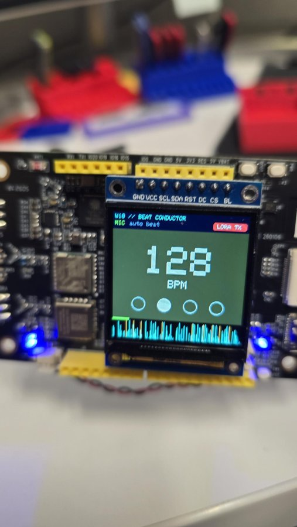
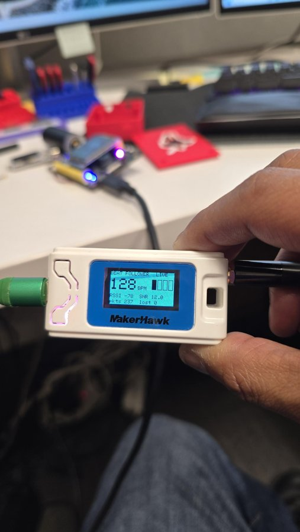
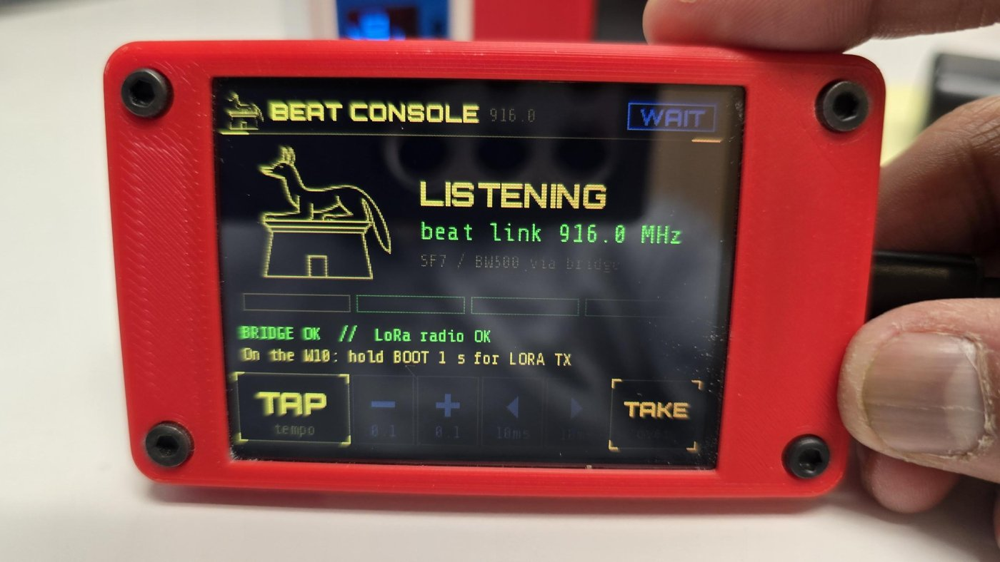
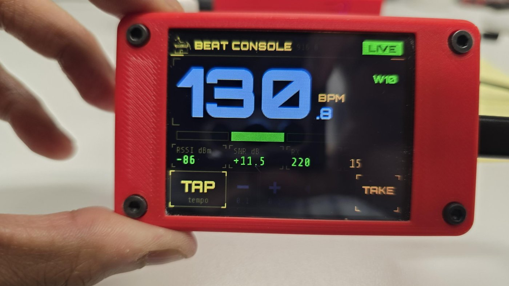
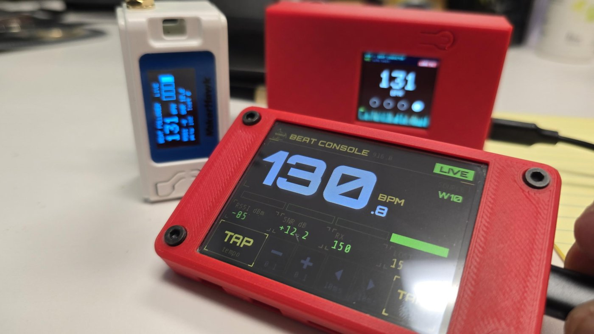
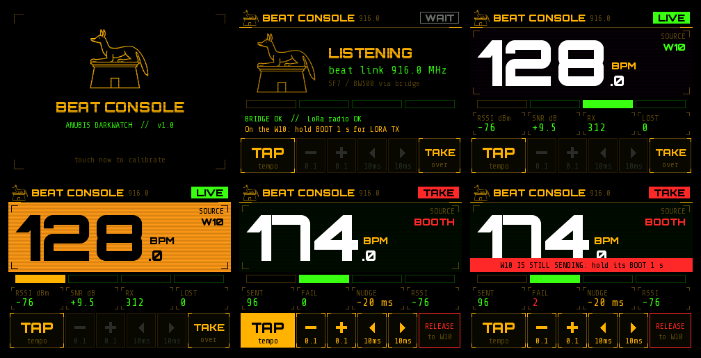
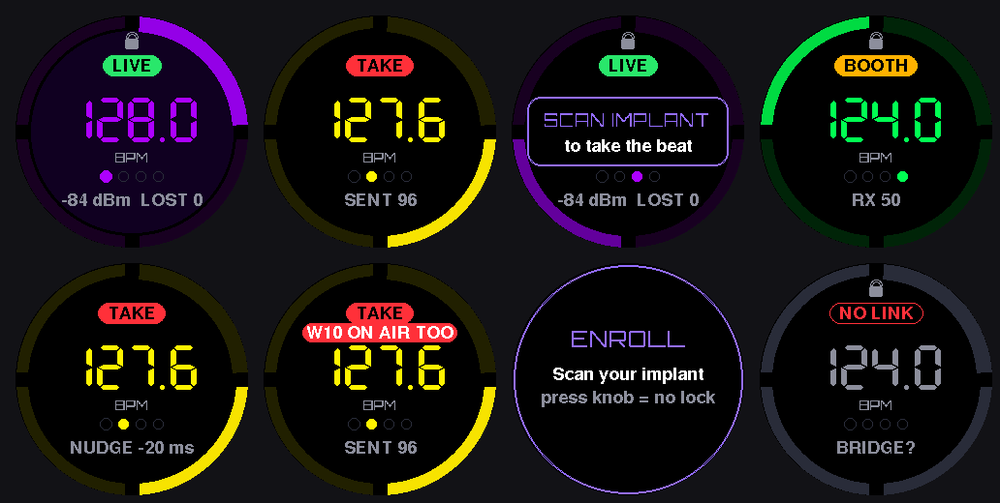
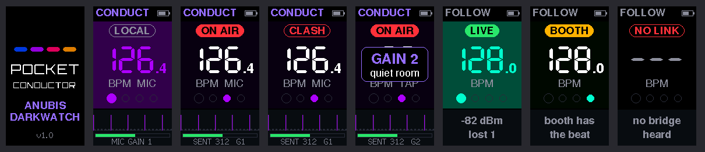

# W10 Beat Conductor

A beat-synced light show for the
[Meshnology W10 LoRa AIoT Dev Kit](https://meshnology.com/products/meshnology-w10-lora-aiot-dev-kit-esp32-s3-long-range-iot-development-board)
(ESP32-S3). It listens to the room through the onboard mic, locks onto the BPM, and flashes the
1.54" screen and RGB LED on every beat. It can also broadcast each beat over LoRa so other boards can
flash in sync, for DJ sets, stages or a crowd holding boards across a venue.

Companion project: [W10-ISM-Waterfall](https://github.com/anubisdarkwatch/W10-ISM-Waterfall).

**New:** a touchscreen [booth console](#booth-console-cyd--heltec-v3-bridge) on a CYD that shows the beat link live and can take over the beat.

| W10 conductor (mic, LoRa TX) | Heltec V3 follower (LoRa RX) |
|---|---|
|  |  |

## Flash it from the browser (no Arduino IDE)

Every board in the system has a ready-made `.bin`. Chrome or Edge on desktop:

1. Plug the board in over USB, open https://espressif.github.io/esptool-js/, click **Connect** and pick its port.
2. Set the flash address to **0x0**, choose the file, click **Program**.
3. When it finishes, unplug and replug (or press RST).

| Board | Role | File |
|---|---|---|
| Meshnology W10 | Conductor (mic, LoRa TX) | [`firmware/W10-Beat-Conductor-v1.0.bin`](firmware/W10-Beat-Conductor-v1.0.bin) |
| Heltec WiFi LoRa 32 V3 | Follower (flashes on the beat) | [`firmware/Beat-Follower-HeltecV3-v1.0.bin`](firmware/Beat-Follower-HeltecV3-v1.0.bin) |
| Heltec WiFi LoRa 32 V3 | Bridge for the booth console | [`firmware/Beat-Bridge-HeltecV3-v1.0.bin`](firmware/Beat-Bridge-HeltecV3-v1.0.bin) |
| CYD (ESP32-2432S028R) | Booth console | [`firmware/CYD-Beat-Console-v1.0.2.bin`](firmware/CYD-Beat-Console-v1.0.2.bin) |
| M5Stack M5Dial | Handheld takeover controller | [`firmware/M5Dial-Beat-Dial-v1.0.bin`](firmware/M5Dial-Beat-Dial-v1.0.bin) |
| M5Stack StickS3 | Pocket conductor (mic) / beat badge | [`firmware/StickS3-Pocket-Conductor-v1.0.3.bin`](firmware/StickS3-Pocket-Conductor-v1.0.3.bin) |

If **Connect** fails, put the board in download mode and try again: hold **BOOT** (Heltec: **PRG**) while
plugging in, or hold it, tap **RST**, then release. On the W10, turn the LoRa beat link on with a 1 s hold of
BOOT once it's running.

## What it does

- **Beat detection from the mic** (ES8311 codec): kick-drum band + full-band onset detection every 8 ms
- **Tempo by autocorrelation** over the last ~6 s, checked against beat-period harmonics so off-beat bass doesn't fool it; locks in ~10 s
- **Phase lock**: folds recent onsets at the beat period so flashes land on the kick, not the off-beat
- **Tap tempo** on BOOT overrides the mic for 15 s; the first tap sets beat 1
- **Screen**: full-panel color flash on each beat, big BPM readout, 1-2-3-4 bar counter (downbeat in amber), color shift every bar, live onset scope + level meter
- **RGB LED** (WS2812 on GPIO48) flashes with the beat
- **LoRa beat link** (off by default): 7-byte packet per beat on 916.0 MHz, SF7 / BW500, 10 dBm

Tested against synthetic tracks from 90 to 174 BPM (kick only, kick + off-beat bass + hats, noisy mixes):
tempo within 0.5 BPM, flashes within ~10 ms of the kick. On a real 128 BPM kick track it reads 127.4–128.1.

## Controls

| Action | Result |
|---|---|
| Tap **BOOT** on the beat | Tap tempo (overrides the mic for 15 s, first tap = beat 1) |
| Hold **BOOT** 1 s | LoRa beat broadcast on / off |

## Beat packet (for follower boards)

```c
struct __attribute__((packed)) BeatPacket {
  uint8_t  m0, m1;   // 'B', 'T'
  uint8_t  seq;      // increments every beat
  uint16_t bpm10;    // BPM x 10, little-endian
  uint8_t  beat;     // 0..3 position in the bar (0 = downbeat)
  uint8_t  hue;      // current color (0..255), changes every bar
};
```

LoRa: 916.0 MHz, SF7, BW 500 kHz, CR 4/5, preamble 8, explicit header, CRC on, default private sync word.
A follower just listens on those settings and flashes when a packet arrives (~10 ms airtime).
916.0 MHz sits clear of the Meshtastic US default (906.875) and the US LoRaWAN channel plan.

## Follower: Heltec WiFi LoRa 32 V3

`heltec_v3_beat_follower/heltec_v3_beat_follower.ino` turns a Heltec V3 into a follower that flashes in sync with the conductor.

- Listens on 916.0 MHz, SF7 / BW500, and flashes the white LED and the OLED (full-screen invert) on every received beat; the downbeat is brighter
- OLED shows BPM, the 1-2-3-4 bar position, RSSI / SNR and packet / loss counts, with **LIVE**, **HOLD** or **WAIT** status
- **Flywheel:** if packets drop, it keeps flashing at the last tempo for 4 s (status **HOLD**)
- Optional WS2812 strip on GPIO47 (set `STRIP_LEN`, needs Adafruit NeoPixel), colored by the conductor's hue, which changes every bar
- Prints an I2C scan at boot, so a dead OLED shows up in the serial log

Tested on a desk with no losses: 300+ packets, RSSI around −75 dBm, SNR around +10 dB.

Build: board **ESP32S3 Dev Module**, USB CDC On Boot **Disabled** (the V3 uses a USB-UART bridge), PSRAM **Disabled**,
library **Adafruit GFX**. Serial monitor at 115200.

Heltec V3 pins: LoRa NSS 8, SCK 9, MOSI 10, MISO 11, RST 12, BUSY 13, DIO1 14 (TCXO on DIO3 at 1.8 V);
OLED SDA 17, SCL 18, RST 21, power via Vext (GPIO36, LOW = on); LED 35.

Ready-made Heltec V3 devices such as the [Meshnology N33 / N35](https://meshnology.com/collections/all) (cased, with battery) run this follower as-is.
Any SX1262 board can follow: copy the radio settings and the `BeatPacket` struct.

## Booth console: CYD + Heltec V3 bridge

A 2.8" touchscreen for the DJ booth. It shows the beat link live (huge BPM, a full-panel flash in the
conductor's colour on every beat, the 1-2-3-4 bar, RSSI / SNR / losses) and can **take over the beat**:
tap tempo, fine-tune and nudge from the touchscreen, and every follower in the room keeps flashing.

| Bridge found, waiting for the W10 | Live on the beat link | Console, Heltec follower and W10 conductor |
|---|---|---|
|  |  |  |

Every screen (rendered from the firmware's own drawing code):



```
W10 conductor ──LoRa 916.0 MHz──► Heltec V3 bridge ──ESP-NOW──► CYD console
                                         ▲                          │
       followers ◄──LoRa (takeover)──────┴────────ESP-NOW (FIRE)────┘
```

The CYD (ESP32-2432S028R) has no LoRa radio, so a Heltec V3 does the radio work. The bridge needs no
screen: a V3 with a dead OLED is perfect for this. No soldering anywhere, just two USB cables.

### Flash it (browser, no installs)

Use the steps in [Flash it from the browser](#flash-it-from-the-browser-no-arduino-ide) with
`CYD-Beat-Console-v1.0.2.bin` on the CYD and `Beat-Bridge-HeltecV3-v1.0.bin` on the Heltec V3.

**First boot of the CYD:**
1. **Display check.** CYD batches use different panels, so the image can come out mirrored or with red and
   blue swapped. Tap **BOOT** to step through the four settings until "<< THIS SIDE IS LEFT" reads normally and
   the AMBER / RED / BLUE blocks match their labels, then hold **BOOT** for 2 s to save.
2. **Touch calibration.** Tap three crosses with a fingernail or stylus.

Both are remembered. To redo them, hold **BOOT** (display) or touch the screen (calibration) during the boot splash.
The console uses the resistive-touch CYD (ESP32-2432S028R, XPT2046).

### Using it

| Control | Action |
|---|---|
| **TAP** | Tap tempo. The first tap is the downbeat. Tapping while following takes over the beat. |
| **−** / **+** | 0.1 BPM per press, hold for 1 BPM steps (takeover only) |
| **◀** / **▶** | Move the beat 10 ms earlier / later (takeover only) |
| **TAKE** / **RELEASE** | Take the beat from the W10 at its current tempo and phase, or hand it back |
| Hold the header 2 s | Rotate 180° (remembered) |

Status pill: **WAIT** (nothing heard yet), **LIVE** (following the W10), **HOLD** (packets dropped, flywheel
keeps time for 4 s), **TAKE** (the booth is driving), **NO LINK** (no bridge heard for 3 s).

**Takeover:** TAKE continues the W10's beat grid without a skip, so the room doesn't see a glitch. Then switch
the W10's **LORA TX** off (hold BOOT 1 s on it). If the console still hears the W10, a red banner says so:
two transmitters on the link collide. RELEASE hands back; followers flywheel until the W10 is on air again.
The bridge carries the W10's sequence numbers on, so followers don't count false losses.

During takeover the console flashes 11 ms after it sends (`LINK_AIR_MS`), which is when the followers
actually flash after LoRa airtime, so the booth screen and the crowd stay in sync.

The CYD's RGB LED flashes with the beat too; the Heltec's white LED blinks per beat heard and double-blinks
per beat sent.

### Build from source

Arduino IDE 2.x, **esp32 by Espressif** core 2.x or 3.x. No extra libraries for either sketch.

| Sketch | Board | Settings |
|---|---|---|
| `cyd_beat_console/` | ESP32 Dev Module | defaults |
| `heltec_v3_espnow_bridge/` | ESP32S3 Dev Module | USB CDC On Boot **Disabled**, PSRAM **Disabled** |

Options at the top of each sketch:
- `LINK_NET_ID` / `LINK_ESPNOW_CH` in `link.h` (keep every copy identical) to run two rigs side by side.
- `PANEL_ST7789 1` for the "2-USB" CYD variant; `PANEL_INVERT` if colours look negative. Mirroring and colour order are set on the device (display check), with `PANEL_MIRROR` / `PANEL_BGR` as the defaults.
- `LINK_POWER_DBM` on the bridge (takeover TX power, default 10 dBm like the W10).
- `DEBUG_TOUCH 1` prints raw touch readings.

The console draws in 24-row bands (about 15 KB of RAM for the whole UI) with the Orbitron and Share Tech Mono
brand fonts baked in as 4-bit anti-aliased bitmaps (`tools/mkfonts_console.py`, fonts SIL OFL 1.1).
PC previews of every screen: `g++ -std=c++17 -I cyd_beat_console tools/preview_console.cpp -o preview && ./preview outdir`.

Both boards print a log at 115200: the bridge one CSV line per beat (`RX,seq,bpm,beat,hue,rssi,snr` /
`TX,...`), the console a status line every 2 s.

### Link frame (ESP-NOW, broadcast)

`LinkFrame` in `link.h`, 18 bytes: magic `'A','D'`, version 1, net id, type (`R` relay, `H` heartbeat,
`F` fire, `A` TX ack), then seq, bpm×10, beat, hue, RSSI, SNR×4, flags, count.

## Handheld controller: M5Dial



The M5Stack M5Dial (round 240×240 touchscreen, rotary knob, 13.56 MHz RFID reader) joins the same ESP-NOW link as
the CYD console, through the same Heltec V3 bridge. It needs no radio of its own. While following, the ring
flashes in the conductor's colour with beat 1 at the top. After TAKE, the Dial keeps time itself and the bridge
transmits each beat on LoRa.

**Flash it:** use [the browser steps](#flash-it-from-the-browser-no-arduino-ide) with `M5Dial-Beat-Dial-v1.0.bin`.
The M5Dial uses the ESP32-S3's built-in USB, so it normally connects without touching any buttons.

**First boot: enroll.** Scan the tags (or implant) that are allowed to take the beat, up to 4, then press the knob.
Press the knob without scanning anything to run with the lock off. Hold the knob while powering up to enroll again.

| Control | Action |
|---|---|
| Scan an enrolled tag | TAKE: the Dial takes the beat at the W10's current tempo and phase |
| Press the knob (following) | Lock on: opens a 6 s scan window. Lock off: TAKE |
| Turn | 0.1 BPM per click, 0.5 BPM when spun fast (takeover only) |
| Press + turn | Move the beat 10 ms earlier / later per click (takeover only) |
| Tap the screen | Tap tempo, first tap = downbeat (takeover, or following with the lock off) |
| Press the knob (takeover) | RELEASE: hand the beat back. The lock applies again. |

Status pill: **WAIT**, **LIVE** (following the W10), **BOOTH** (following another controller's takeover),
**HOLD**, **TAKE**, **NO LINK**. While the Dial has the beat, a red **W10 ON AIR TOO** banner means the W10 or
another controller is still transmitting.

The tag lock checks the tag's UID only. It's a booth convenience to stop stray hands, not real security: UIDs can be cloned.
The reader is polled only while following, so scanning never delays a beat during takeover. Implants with a small
coil (NExT, xNT) need to sit flat right on the screen, near the middle.

**Works with the CYD console.** During takeover, the Dial re-broadcasts each beat the bridge confirms
(a `R` relay frame with the `LINK_FLAG_ECHO` flag), so a CYD in follow mode keeps showing the booth's tempo. The CYD
shows 0 dBm for those beats, since they didn't come over LoRa. If both controllers take over at once, each one
shows the conflict banner.

**Build from source:** Arduino IDE 2.x, esp32 by Espressif 3.x, board **M5Dial**, library **M5Dial** (installs
M5Unified and M5GFX). Options at the top of `m5dial_beat_dial.ino`: `ENC_PER_CLICK`, `BRIGHTNESS`, `MAX_TAGS`,
`CLICK_SOUND`. Serial log at 115200 prints each scanned tag's UID. The screens are in `m5dial_beat_dial/ui.h`.
`tools/build_preview.sh <M5GFX folder> <out folder> preview_dial.cpp` renders them on a Linux PC (needs SDL2 headers).

## Pocket conductor: M5StickS3



The W10's beat engine running on the M5Stack StickS3's onboard mic, with no LoRa radio needed. **ON AIR** sends
each beat over ESP-NOW to the Heltec V3 bridge, which transmits it on the beat link. Followers, the CYD
console and the M5Dial all follow the StickS3 the same way they follow the W10. Like the Dial, it re-broadcasts each beat the bridge confirms,
so a CYD in follow mode shows its tempo. Switch to **FOLLOW** and it becomes a pocket badge that flashes in the
conductor's colour.

**Flash it:** use [the browser steps](#flash-it-from-the-browser-no-arduino-ide) with
`StickS3-Pocket-Conductor-v1.0.3.bin`.

| Button | CONDUCT | FOLLOW |
|---|---|---|
| Front button (KEY1), tap | Tap tempo: taps override the mic for 15 s, first tap = beat 1 | |
| Front button, hold 1 s | **ON AIR** on / off | |
| Side button (KEY2), tap | Mic gain: club / loud room / quiet room / max (remembered) | |
| Side button, hold 1 s | Switch to FOLLOW | Switch to CONDUCT |

It starts **LOCAL** (beat on screen only). Turn the W10's **LORA TX** off before going ON AIR. If the bridge still
hears the W10, or another controller is sending, the pill turns to **CLASH**. The panel at the bottom shows the onset
scope (bright ticks = detected hits) and the mic level. If the level bar sits near the end, lower the gain. If it barely
moves, raise it.

The bottom line also shows which mic path is running: **M5** (M5Unified's mic driver) or **I2S** (a direct
ES8311 + I2S set-up, used if the first fails). If both fail, CONDUCT shows **MIC FAILED** with the step codes
and the driver's own error name, which are also printed on the serial log at 115200. With no working mic it
starts in FOLLOW so it still syncs with the rig.

**Build from source:** Arduino IDE 2.x, esp32 by Espressif 3.x, board **ESP32S3 Dev Module** with Flash Size 8MB,
PSRAM **OPI PSRAM**, USB CDC On Boot **Enabled**. Library **M5Unified** (installs M5GFX). The beat engine is in
`sticks3_pocket_conductor/beat_engine.h`, copied from the W10 sketch. Screens are in `ui.h`; preview them with
`tools/build_preview.sh <M5GFX folder> <out folder> preview_stick.cpp`.

## Hardware notes (W10)

| Function | Pins |
|---|---|
| I2C (codec, MCP23017, sensors) | SDA = GPIO8, SCL = GPIO7 |
| I2S to ES8311 | MCLK = 1, BCK = 2, LRCK = 4, DOUT = 5, DIN (mic) = 3 |
| Shared SPI (LoRa + LCD) | SCK = 12, MOSI = 13, MISO = 11 |
| LoRa NSS / NRST / BUSY | GPIO14 / MCP23017 GPA3 / GPB2 |
| LCD (ST7789 240×240) | CS = 10, DC = 16, BL = 6, RST = MCP23017 GPA1 |
| WS2812 RGB LED | GPIO48 |
| Speaker amp enable | MCP23017 GPA7 (kept off: mic only) |

Mic setup: ES8311 analog mic, PGA max, 30 dB mic gain, 16 kHz / 16-bit I2S. Audio runs in its own
FreeRTOS task on core 0 so screen redraws never drop samples.

## Build

Arduino IDE 2.x, **esp32 by Espressif** core 3.x, library **Adafruit GFX**.

Board **ESP32S3 Dev Module**: USB CDC On Boot **Enabled**, PSRAM **OPI PSRAM**.

Open `w10_beat_conductor/w10_beat_conductor.ino` and upload. Serial monitor (115200) prints the BPM,
tempo estimate, confidence, onsets per second and mic level once a second.

## Tips

- Works best with real bass: it listens for kicks. Thin clicks through laptop speakers barely register.
- Slow tracks (< ~90 BPM) may lock at double time, which still flashes in time. Tap BOOT to force it.
- If you transmit under an amateur license, add your callsign ID to the beat link.

## Roadmap

- Latency compensation on followers (~10 ms LoRa airtime)
- Followers for XIAO ESP32S3 + Wio-SX1262 and other SX1262 boards
- Bluetooth MIDI clock input from DJ software
- Tilt-controlled effects via the onboard QMI8658 IMU

## License

MIT, see [LICENSE](LICENSE).

## Credits

Built by Anubis Darkwatch with Claude.

Hardware provided by [Meshnology](https://meshnology.com): thanks for supplying the [Meshnology W10 LoRa AIoT Dev Kit](https://meshnology.com/products/meshnology-w10-lora-aiot-dev-kit-esp32-s3-long-range-iot-development-board) for this project. Pin mapping and peripheral details come from Meshnology's W10 documentation and demos.
